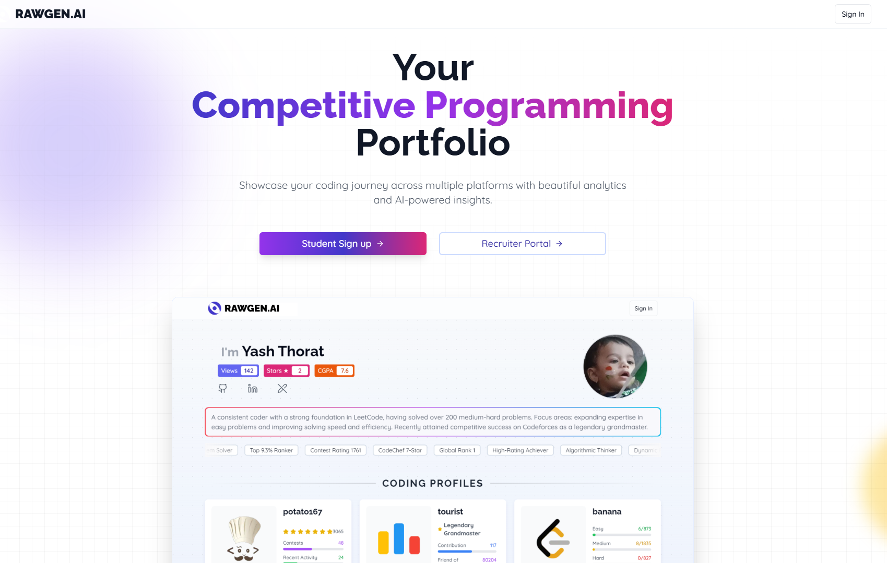

# 🚀 RawGen AI:



**RawGen AI** is a premium, high-performance analytics platform designed to consolidate a developer's algorithmic prowess and engineering projects into a single, unified ecosystem. It bridges the gap between competitive programming excellence and real-world project portfolios, offering recruiters and developers a "raw" look at verified skill data. Built with the "Vibe-Hand" architecture, it combines state-of-the-art aesthetics with custom, handwritten data extraction logic.

[](https://nextjs.org/) [](https://reactjs.org/) [](https://tailwindcss.com/) [](https://convex.dev/) [](https://clerk.com/) [](https://groq.com/)

---

## ✨ Features & Highlights

### 📊 Unified CP Dashboard

- **Multi-Platform Integration**: Aggregated statistics from LeetCode, Codeforces, CodeChef, and GeeksForGeeks.
- **Handwritten Scraping Engine**: Custom, zero-proxy scraping logic utilizing JSDOM and GraphQL for raw accuracy.
- **Real-Time Sync**: Background background updates ensuring statistics are never stale (12h SWR refresh).
- **Dynamic Reordering**: Drag-and-drop platform cards to prioritize what recruiters see first.

### 💼 Integrated Developer Portfolio

- **Project Showcase**: Rich display of GitHub projects with tech stack tagging and deployment links.
- **Skill Matrix**: Categorized technical skills using a tiered progression system (Fundamental, Intermediate, Advanced).
- **Certificate Vault**: Secure storage and verification of professional certifications.
- **Profile Customization**: Detailed profile cards with social integration and contribution heatmaps.

### 🤖 Intelligent Analytics

- **Groq AI Insights**: Automated candidate analysis and personalized suggestions powered by Llama 3.1.
- **Visual Analytics**: Interactive circular progress bars, activity heatmaps, and ranking charts.
- **Detailed Stats**: Deep-dive metrics including difficulty-wise problem breakdowns and streak tracking.

### 🕵️ Recruiter Intelligence Suite

- **Verified Candidates**: Specialized portal for recruiters to search and verify developer credentials.
- **Analytical Search**: Filter candidates by platform ranking, coding score, and technical skill sets.
- **Candidate Starring**: High-speed "bookmarking" system for top-performing developers.
- **Secure Access**: Gatekeeper authentication ensuring only permitted recruiters access analytical data.

### 🎨 Premium Aesthetics (Vibecoded)

- **Glassmorphism UI**: High-end transparency effects, backdrop blurs, and neon accents.
- **Adaptive Theming**: Components that inherit vibrant color palettes based on platform identities (LeetCode Orange, Codeforces Blue).
- **Micro-animations**: Hardware-accelerated transitions and interactive followers using Framer Motion.
- **Typography Precision**: Professional font stack emphasizing clarity and modern design.

---

## 🛠 Tech Stack

### Frontend

- **Framework**: Next.js 16 (App Router & Server Actions)
- **UI Context**: React 19 (Concurrent rendering)
- **Styling**: Tailwind CSS v3.4 (Design system utilities)
- **Icons**: Lucide React + Tech Stack Icons
- **Animations**: Framer Motion (State-aware transitions)
- **Components**: shadcn/ui + custom modular components

### Backend

- **Database**: Convex (Reactive database with real-time subscriptions)
- **Authentication**: Clerk (Universal identity platform)
- **AI Engine**: Groq SDK (Powered by Llama 3.1 8B Instant)
- **Data Extraction**: JSDOM + Cheerio (Headless DOM parsing)
- **Hosting/Edge**: Next.js Server Components & Middleware
- **Type Safety**: TypeScript 5 (Strict mode)

---

## 📂 Project Structure

```text
rawgen-ai/
├── app/                          # Next.js App Router
│   ├── (auth)/                   # Authentication route grouping
│   ├── [username]/               # Dynamic public portfolio routes
│   ├── api/                      # The "Handwritten" Engine
│   │   ├── check/                # Cross-platform existence validator
│   │   ├── codechef/             # CodeChef JSDOM scraper
│   │   ├── codeforces/           # CF Signed API handler
│   │   ├── geeksforgeeks/        # GFG metadata extractor
│   │   └── leetcode/             # GraphQL orchestration
│   ├── dashboard/                # User dashboard interface
│   ├── recruiter/                # Recruiter analytical portal
│   └── layout.tsx                # Global providers & structure
├── components/                   # Vibecoded UI Components
│   ├── dashboard/                # Central dashboard modules
│   │   ├── leetcode/             # LeetCode-specific visuals
│   │   ├── codechef/             # CodeChef-specific visuals
│   │   └── ...                   # Extended platform components
│   ├── landing/                  # Premium landing experience
│   ├── layout/                   # Shared structural navigation
│   ├── platform-stats/           # Atomic progress & stats trackers
│   ├── profile/                  # Identity management cards
│   ├── project/                  # Portfolio asset components
│   ├── recruiter/                # Specialized analytical filters
│   ├── skill/                    # Tiered skill matrix views
│   └── ui/                       # Base accessible primitives
├── convex/                       # Reactive Data Layer
│   ├── schema.ts                 # Relational schema & indexes
│   ├── users.ts                  # User syncing & identity logic
│   ├── profiles.ts               # Platform linking mutations
│   ├── skills.ts                 # Skill categorization logic
│   └── recruiters.ts             # Analytics access management
├── lib/                          # Core Business Logic
│   ├── extractors/               # Data transformation layer
│   │   ├── index.ts              # Universal registry
│   │   └── leetcodeExtractor.ts  # Schema normalization
│   ├── PlatformState.tsx         # Global state & SWR machine
│   ├── types.ts                  # 400+ lines of data schemas
│   └── utils.ts                  # Shared formatting utilities
├── public/                       # Static branding & assets
└── tailwind.config.ts            # Design system tokens
```

---

## 🚀 Getting Started

### Prerequisites

- **Node.js**: v20.x or higher
- **Convex Account**: For reactive database ([Convex](https://convex.dev/))
- **Clerk Account**: For authentication ([Clerk](https://clerk.com/))
- **Groq API Key**: For AI insights ([Groq](https://console.groq.com/))

### Installation

1. **Clone the repository**:

   ```bash
   git clone https://github.com/yashthorat7/rawgen-ai.git
   cd rawgen-ai
   ```

2. **Install dependencies**:

   ```bash
   npm install --legacy-peer-deps
   ```

3. **Setup Environment Variables**: Create a `.env.local` file in the root directory:

   ```env
   # Convex Configuration
   NEXT_PUBLIC_CONVEX_URL=your_convex_url
   CONVEX_DEPLOYMENT=your_deployment_id

   # Clerk Auth
   NEXT_PUBLIC_CLERK_PUBLISHABLE_KEY=your_clerk_pub_key
   CLERK_SECRET_KEY=your_clerk_secret_key

   # Groq AI
   GROQ_API_KEY=your_groq_key

   # Codeforces API (Optional)
   CODEFORCES_API_KEY=your_cf_key
   CODEFORCES_API_SECRET=your_cf_secret
   ```

### Running the Application

1. **Initialize the Backend**:

   ```bash
   npx convex dev
   ```

2. **Launch the Development Server**:

   ```bash
   npm run dev
   ```

3. **Access the application**:
   - Dashboard: `https://rawgenai.vercel.app`
   - Public Profile: `https://rawgenai.vercel.app/your_username`

---

## 🧩 Detailed System Overview

### 💡 "Vibe-Hand" Philosophy

The project is architected on two distinct pillars:
- **Vibecoding (Frontend)**: Every interaction is designed for high aesthetic "vibe" using AI-assisted patterns and modern motion principles.
- **Handwritten (Backend)**: Data isn't just "fetched"; it's meticulously extracted. We bypass brittle proxies by writing custom DOM traversals and GraphQL orchestrators.

### 📦 SWR Data Lifecycle

- **Instant Load**: Data is served immediately from the Convex reactive cache.
- **Stale Check**: The `PlatformState` hook checks if the `lastUpdated` timestamp exceeds 12 hours.
- **Background Sync**: If stale, the handwritten scrapers are triggered atomically in the background.
- **Reactive Update**: As soon as the scraper updates the database, the UI reflects the new stats instantly without a refresh.

### 🛡 Security & Verification

- **Identity Syncing**: Strict one-to-one mapping between Clerk identities and Convex user records.
- **Platform Verification**: Real-time username verification before accounts are linked.
- **Headless Proxies**: Scrapers run on the edge, ensuring client IPs are never exposed to external platform protective layers.

---

## 📡 API Reference

### 🎫 Extraction Endpoints

| Method | Endpoint | Description |
|--------|----------|-------------|
| GET | `/api/leetcode/[username]` | GraphQL stat extraction |
| GET | `/api/codechef/[username]` | JSDOM profile parsing |
| GET | `/api/codeforces/[username]` | Signed API retrieval |
| GET | `/api/geeksforgeeks/[username]` | Metadata CSS parsing |

### 🔍 Verification Endpoints

| Method | Endpoint | Description |
|--------|----------|-------------|
| GET | `/api/check/[platform]/[username]` | Cross-platform check |
| POST| `/api/leetcode/submit/...` | Submission status polling |

---

### ❤️ Developed By

### 👨💻 **Yash Thorat**

Feel free to suggest improvements, or report issues!

⭐ **Don't forget to star this repository if you find it useful!**
